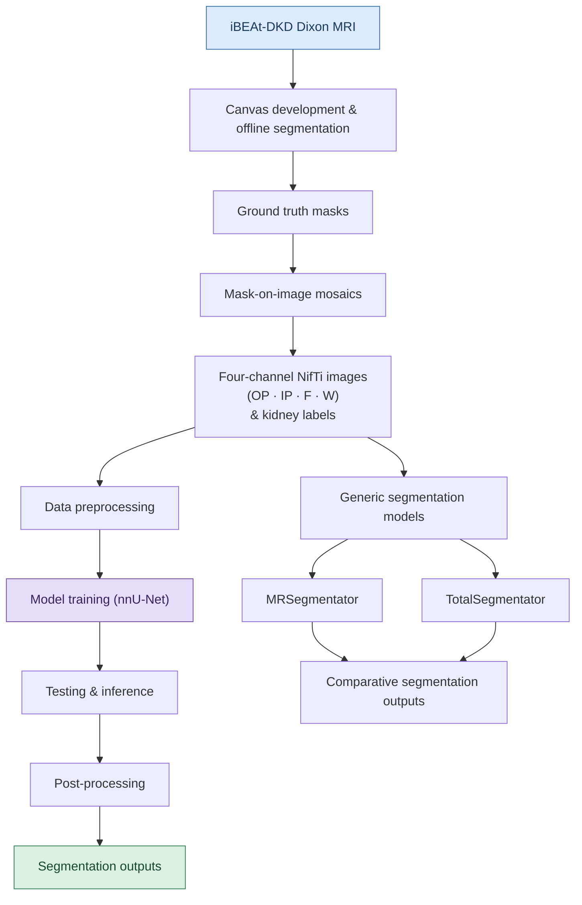

# iBEAtSegmentator: Renal Parenchyma Segmentation in Diabetes

<p align="center">
  <strong>Automated Kidney Segmentation in Diabetes Using Multi-channel Dixon MRI</strong>
</p>

<p align="center">
  
  
  
  
</p>

---

## Overview

**iBEAtSegmentator** is an automated kidney segmentation pipeline developed for multi-channel Dixon MRI data acquired from people with diabetes as part of the iBEAt-DKD study.

The pipeline supports the preparation of ground truth kidney masks, data preprocessing, deep learning model training, inference and post-processing.

The primary segmentation model is based on CNN (nnU-Net) architecture and uses four-channel Dixon MRI inputs:

| Input channel | Dixon MRI |
|---|---|
| 1 | Opposed-phase |
| 2 | In-phase |
| 3 | Fat |
| 4 | Water |


## Pipeline Overview

The iBEAtSegmentator pipeline consists of sequential stages, from ground truth preparation to automated kidney segmentation and post-processing. Alternative segmentation models are also implemented to provide additional segmentation outputs for comparison.




## Contents

- [Requirements](#1-requirements)
- [Installation](#2-installation)
- [Data Organisation](#3-data-organisation)
- [Pipeline Stages](#4-pipeline-stages)
- [References](#5-references)

---

## 1. Requirements

The following are required to run the pipeline:

- Python installation.
- A local copy of this repository.
- Access to the cleaned iBEAt Dixon MRI dataset.
- iBEAt Dixon MRI dataset record.
- Appropriate computational resources:
  - CPU for data preparation and preprocessing.
  - GPU for deep learning model training and inference.

## 2. Installation

### Local desktop environment

Install the required Python packages using:

```bash
pip install -r segment_local_requirements.txt
```

### High-performance computing (HPC) environment

For GPU-enabled environments, create the Conda environment using:

```bash
conda env create -f segment-gpu.yml
```

Activate the environment:

```bash
conda activate <environment_name>
```

## 3. Data Organisation

The pipeline expects the input data to follow this directory structure:

```text
iBEAt_Build/
└── ibeatsegmentator/
    └── stage_0_dixon_data/
        ├── Controls/
        └── Patients/
```

The root directory must be named `iBEAt_Build`, containing an `ibeatsegmentator` subdirectory with the cleaned iBEAt Dixon MRI data provided by MIBLAB.

The original iBEAt-DKD Dixon dataset may initially be named `stage_5_clean_dixon_data`. This directory will be renamed to `stage_0_dixon_data` during the canvas computing stage.

**Input data are treated as read-only.** The original dataset is not modified during pipeline execution. All intermediate processing files, segmentation outputs and model results are generated in separate stage-specific directories.

### Expected output structure

As the pipeline progresses, the following directory structure will be generated:

```text
iBEAt_Build/
└── ibeatsegmentator/
    ├── stage_0_dixon_data/
    │   ├── Controls/
    │   └── Patients/
    ├── stage_1_canvas/
    ├── stage_2_gui_data/
    ├── stage_3_kidney_masks/
    ├── stage_4_displays/
    ├── stage_5_data_prep/
    ├── stage_6_preprocess/
    ├── stage_7_results/
    ├── stage_8_testing/
    ├── stage_9_postprocess/
    └── stage_10_other_models/
        ├── mrseg/
        └── totseg/
```

## 4. Pipeline Stages

### Stage 1: Canvas Generation

Generates kidney canvases to facilitate semi-automated kidney segmentation using a graphical user interface (GUI).

These canvases provide the initial framework for manual interaction and segmentation.

### Stage 2: GUI Segmentation Data

A separate copy of the Stage 1 canvas data is created and renamed `stage_2_gui_data`. This isolates the manual segmentation workflow from the original canvas data.

This stage supports offline generation and editing of kidney masks through the GUI. The resulting segmentations are initially stored in the legacy dbdicom format.

### Stage 3: Kidney Mask Generation

Extracts and organises the final kidney segmentation masks into a dedicated directory.

The masks are exported as DICOM segmentation series with appropriate metadata using the updated dbdicom implementation.

### Stage 4: Ground Truth Visualisation

Generates .png visualisations of the segmented left and right kidneys overlaid on the corresponding opposed-phase Dixon MRI.

These mosaics provide a visual quality-control mechanism for reviewing the ground truth segmentations.

### Stage 5 & 5a: Data Preparation

Prepares the Dixon images and corresponding ground truth segmentations for deep learning model development.

DICOM images are converted into four-channel NIfTI volumes for compatibility with nnU-Net.

The dataset is randomly partitioned into designated training and testing subsets. Data integrity checks are also performed to identify missing or unmatched image-segmentation pairs.

The resulting directory contains:

1. `imagesTr/` - training images.
2. `labelsTr/` - corresponding training ground truth labels.
3. `imagesTs/` - held-out testing Dixon MRI dataset.
4. `labelsTs/` - corresponding testing ground truth labels.
5. `dataset.json` - dataset configuration and metadata.
6. `incomplete_set` - incomplete 4-channel set, missing/excluded images/labels,  

### Stage 6: Data Preprocessing

Contains the preprocessed datasets generated by the cpu-based preprocessing pipeline.

This includes:

- Preprocessed training images.
- Preprocessed ground truth labels.
- Dataset configuration and preprocessing plans required for model training.

The outputs are structured according to nnU-Net requirements.

### Stage 7: Model Training and Results

Stores the nnU-Net training outputs, including:

- Trained model weights and checkpoints.
- Training and validation logs.
- Learning curves and performance visualisations.
- Model configuration files.
- Cross-validation results.

### Stage 8: Model Testing and Inference

Applies the trained segmentation model to the held-out testing dataset.

The model generates predicted kidney segmentation masks for previously unseen MRI volumes. The resulting predictions are saved for subsequent visual inspection and quantitative evaluation by the user.

### Stage 9: Post-processing

Evaluates the predicted segmentation masks to determine whether additional post-processing is required to improve segmentation quality.

Post-processing may include:

- Connected-component analysis.
- Isolation of the largest connected components corresponding to the left and right kidneys.
- Removal of spurious or disconnected segmentation regions.
- Recalculation of segmentation performance metrics.

The objective is to improve anatomical consistency and reduce false-positive segmentation regions.

### Stage 10: Alternative Segmentation Models

Generates renal parenchyma segmentation outputs using two alternative, externally developed generic segmentation models:

- **MRSegmentator** (`other_models/mrseg/`)
- **TotalSegmentator** (`other_models/totseg/`)

These outputs provide additional segmentation references for comparison with the primary iBEAtSegmentator model.

---

## 5. References

The following publications and software should be acknowledged when using the corresponding frameworks and models.

1. **iBEAt-DKD Study**

   Gooding, K.M. et al. (2020). Prognostic imaging biomarkers for diabetic kidney disease (iBEAt): study protocol. *BMC Nephrology*, 21, 242.

   https://doi.org/10.1186/s12882-020-01901-x

2. **nnU-Net**

   Isensee, F., Jaeger, P.F., Kohl, S.A.A., Petersen, J. and Maier-Hein, K.H. (2021). nnU-Net: a self-configuring method for deep learning-based biomedical image segmentation. *Nature Methods*, 18, 203-211.

   https://doi.org/10.1038/s41592-020-01008-z

   Software: https://github.com/MIC-DKFZ/nnUNet

3. **MRSegmentator**

   Häntze, H. et al. (2025). Segmenting Whole-Body MRI and CT for Multiorgan Anatomic Structure Delineation. *Radiology: Artificial Intelligence*, 7(6), e240777.

   https://doi.org/10.1148/ryai.240777

   Software: https://github.com/hhaentze/MRSegmentator

4. **TotalSegmentator**

   Wasserthal, J. et al. (2023). TotalSegmentator: Robust Segmentation of 104 Anatomic Structures in CT Images. *Radiology: Artificial Intelligence*.

   https://doi.org/10.1148/ryai.230024

   Software: https://github.com/wasserth/TotalSegmentator

**Dataset acknowledgement:** The iBEAt-DKD dataset was provided through MIBLAB. Please refer to the relevant iBEAt-DKD study publication and applicable dataset access and acknowledgement requirements.

---

